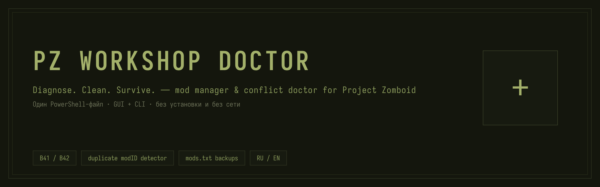
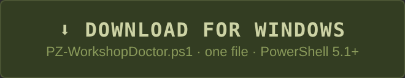
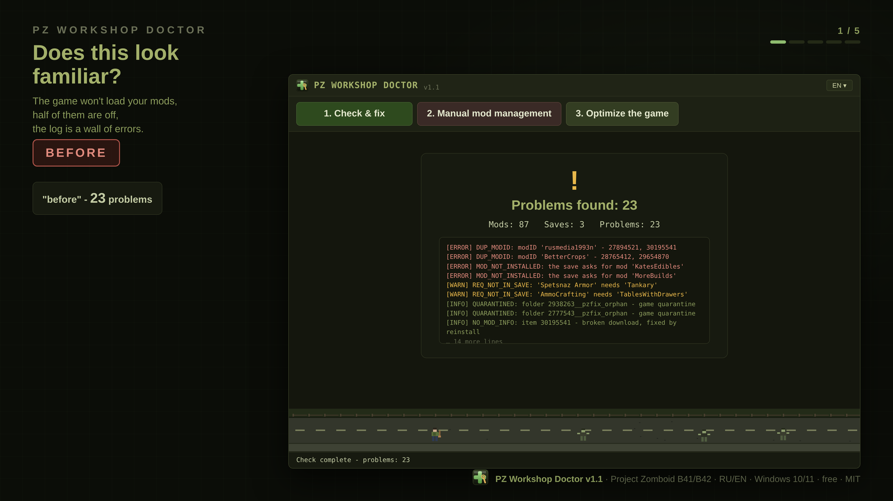
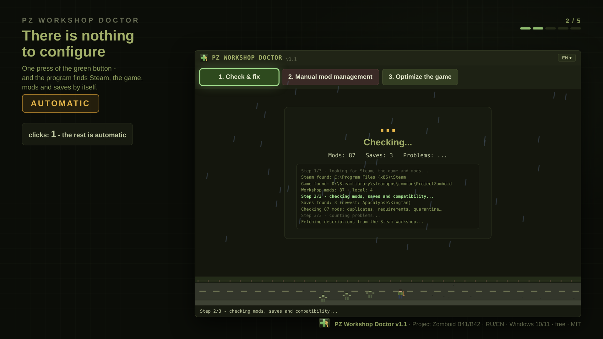
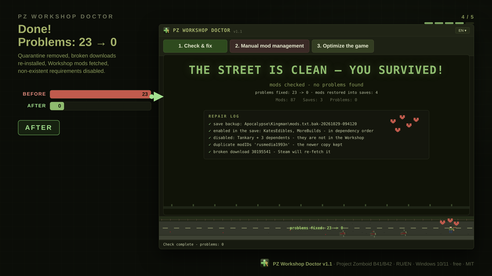
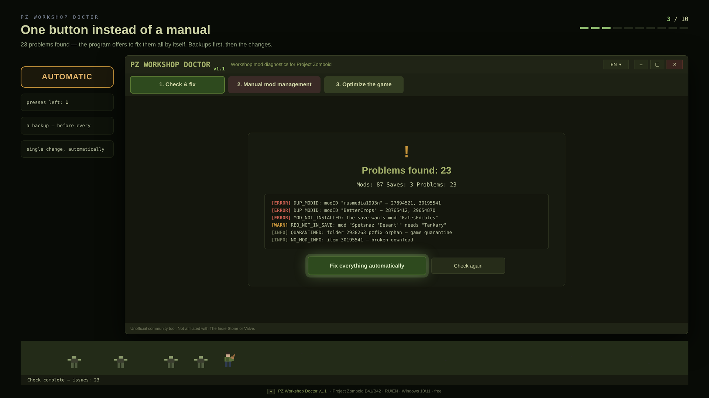
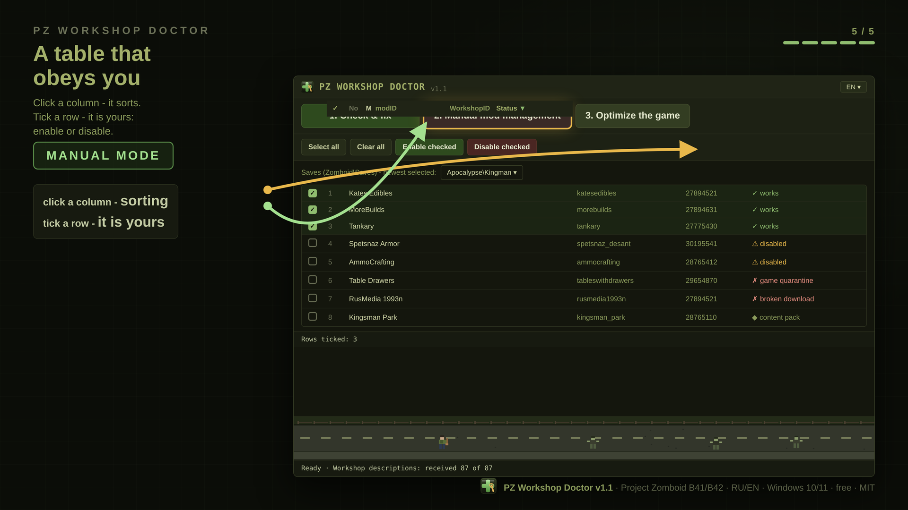

<p align="center">
  
</p>
<p align="center">
  <a href="../../releases/latest"></a>
</p>
<p align="center">
  <a href="README.md"></a>
  <a href="README.ru.md"></a>
  <a href="LICENSE"></a>
</p>

# PZ Workshop Doctor

Unofficial mod doctor for **Project Zomboid** (Steam Workshop). One file, one window, one button: it scans Steam, the saves and every mod by itself, finds the problems the in-game manager cannot see, and fixes them — backups first. While it works, a survivor walks the road along the bottom, the horde shambling behind him — **his walk is the progress bar**: when the round ends he reaches the end of the road, the window reads "THE STREET IS CLEAN — YOU SURVIVED", and the zombies drop dead. When something breaks, the horde catches him and eats him instead.

| It finds everything by itself | One green button | Done |
|---|---|---|
|  |  |  |
| The whole pile of problems, in one window. | Nothing runs until you press it — then the walk is the progress bar. | He made it to the end: the street is clean — you survived. |

| One button instead of a manual | Manual mode: the table obeys you |
|---|---|
|  |  |
| 23 problems found — "Fix everything automatically" does the rest, backups first. | Click any column to sort (status sorts by meaning, ticked rows rise to the top), tick rows, then "Enable checked" / "Disable checked". |

## Install (30 seconds)

1. Download `PZWorkshopDoctor.exe` (or the `.ps1`) from [Releases](../../releases/latest).
2. Run it. Nothing to install — Windows 10/11, PowerShell 5.1 or 7, game B41/B42.

The start shows a "ready to check" card and the street below comes alive — but nothing runs by itself: the check begins exactly when you press the one green button. No settings, no accounts, no popups — and if anything unexpected happens on a live machine, the window names the failing step and keeps working instead of dying with a cryptic error.

## What it actually fixes

- **Missing mods are fetched for you**: the requirement named in `require=` is looked up in the Workshop and its subscribe page opens; Steam downloads it, the program notices and re-checks by itself. A requirement that does not exist in the Workshop at all (deleted or never published)? The mods that demand it — and everything depending on them — are switched off in the saves, with a backup, so the warnings die for good.
- **Manual management, when you want it**: tick mods in the table and press "Enable checked" or "Disable checked" — enabling pulls the installed requirements along, disabling takes the dependents with it (no orphan warnings after your own click), and Build 42's `workshopMods.txt` stays in sync. Click any column header to sort the table — status sorts by meaning rather than alphabet, ticked rows rise to the top, and the order survives every re-check. Every change is one click, one backup.
- Mods that are installed but not enabled in the save — enabled, in dependency order, with a `mods.txt` backup.
- Duplicate modIDs (two Workshop items shipping the same id) and leftovers from unsubscribed mods.
- Broken downloads (no `mod.info`) — removed so Steam re-downloads them; map/tile packs are recognized as content, not errors.
- Full Workshop descriptions, selectable logs, and a real optimizer: game memory (`-Xmx`), Steam launch options, junk logs — every change reversible.

## Terminal, if you prefer

```powershell
powershell -ExecutionPolicy Bypass -File .\PZ-WorkshopDoctor.ps1 -Cli            # full report
powershell -ExecutionPolicy Bypass -File .\PZ-WorkshopDoctor.ps1 -Cli -AutoFix   # check, fix, report before/after
```

## Links

[Releases](../../releases/latest) · [Русское README](README.ru.md) · [MIT License](LICENSE) — community tool, not affiliated with The Indie Stone or Valve.
