<p align="center">
  
</p>
<p align="center">
  <a href="../../releases/latest">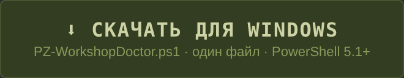</a>
</p>
<p align="center">
  <a href="README.md"></a>
  <a href="README.ru.md"></a>
  <a href="LICENSE"></a>
</p>

# PZ Workshop Doctor

Неофициальный доктор модов для **Project Zomboid** (Steam Workshop). Один файл, одно окно, одна кнопка: сам сканирует Steam, сейвы и все моды, находит то, что внутриигровой менеджер не видит в принципе, и сам чинит — сначала бэкапы. Пока идёт проверка, выживший идёт по дороге внизу, уворачиваясь от толпы зомби позади — **его прогулка и есть индикатор прогресса**: когда всё закончено, он доходит до конца дороги, окно выводит «УЛИЦА ЧИСТА — ТЫ ВЫЖИЛ!» — а зомби умирают. А если что-то ломается — толпа его догоняет и съедает.

**Проверка — от кучи проблем до чистой улицы**

| До | Проверка | Одна кнопка |
|---|---|---|
| [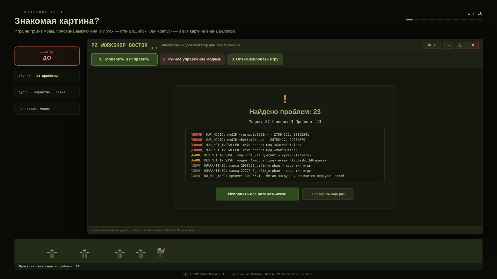](https://genocide12.github.io/pz-workshop-doctor/gallery.html#ru-1) | [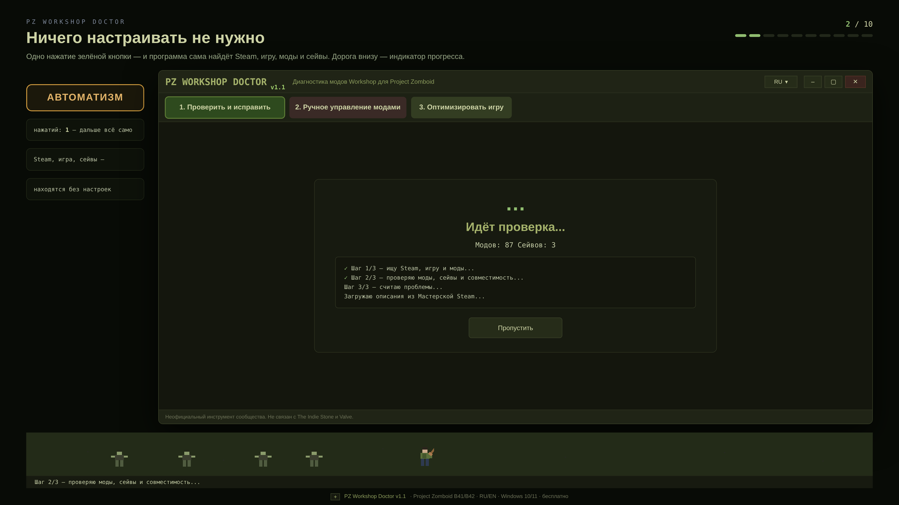](https://genocide12.github.io/pz-workshop-doctor/gallery.html#ru-2) | [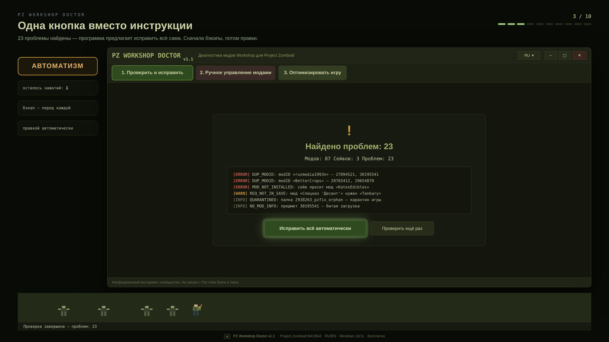](https://genocide12.github.io/pz-workshop-doctor/gallery.html#ru-3) |
| Игра не грузит моды, половина выключена, в логах — стена ошибок: один запуск показывает всю картину. | Одно нажатие зелёной кнопки — Steam, игра, моды и сейвы находятся сами; дорога внизу — индикатор прогресса. | 23 проблемы найдены — «Исправить всё автоматически» сделает остальное, сначала бэкапы. |

| Недостающие моды | Сироты | После |
|---|---|---|
| [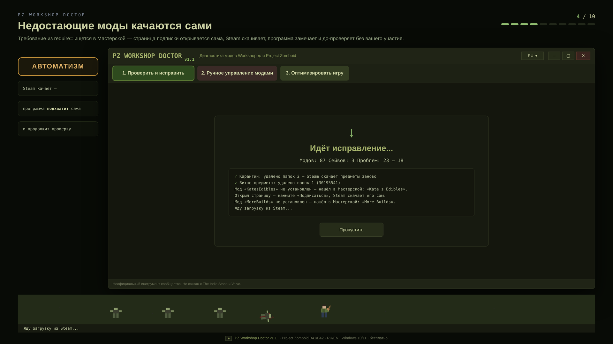](https://genocide12.github.io/pz-workshop-doctor/gallery.html#ru-4) | [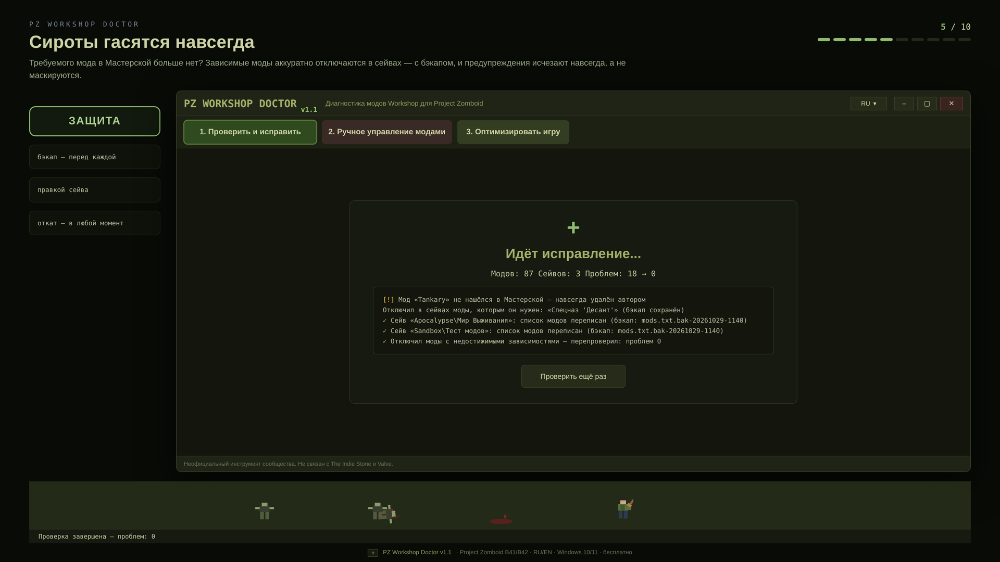](https://genocide12.github.io/pz-workshop-doctor/gallery.html#ru-5) | [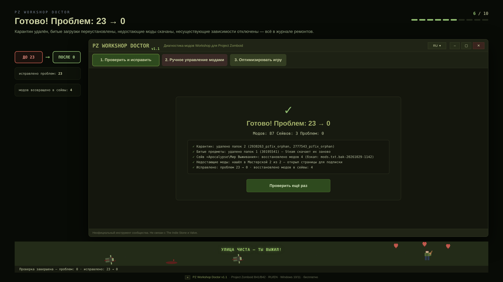](https://genocide12.github.io/pz-workshop-doctor/gallery.html#ru-6) |
| Требование из require= ищется в Мастерской — страница подписки открывается сама, Steam качает, программа замечает и до-проверяет сама. | Требуемого мода в Мастерской нет? Зависимые моды аккуратно отключаются в сейвах — с бэкапом, и предупреждения исчезают навсегда. | Карантин удалён, битые загрузки переустановлены, недостающие моды скачаны — 23 → 0, всё в журнале ремонтов. |

**Ручное управление, детали, оптимизатор, терминал**

| Ручной режим | Детали |
|---|---|
| [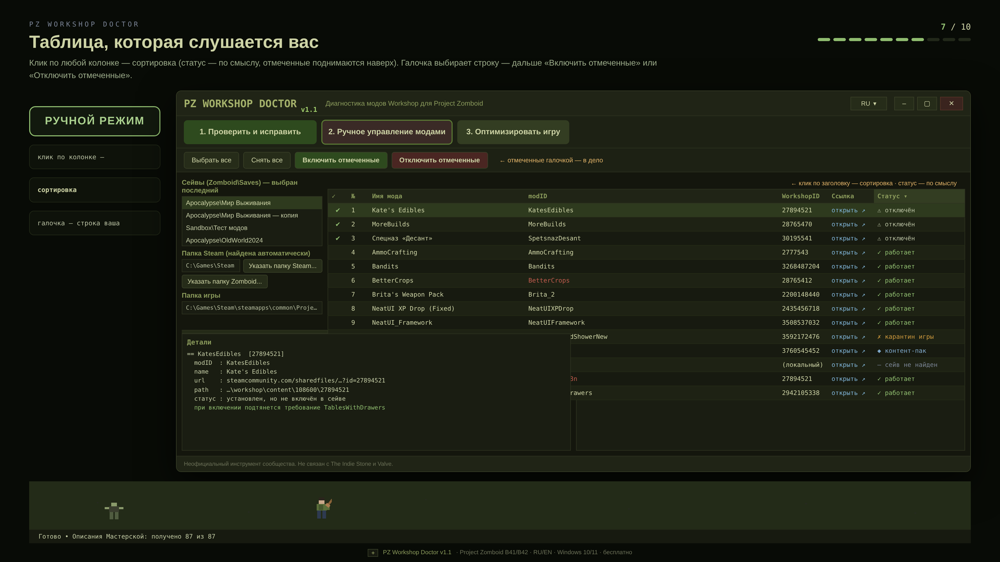](https://genocide12.github.io/pz-workshop-doctor/gallery.html#ru-7) | [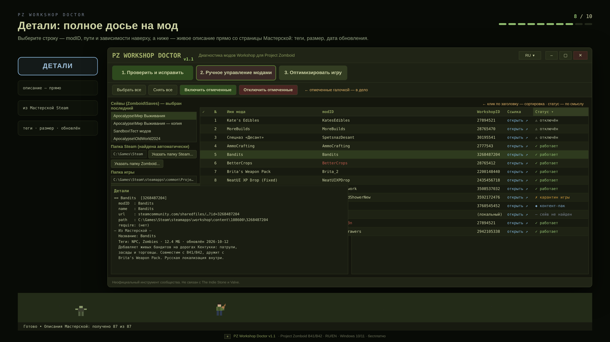](https://genocide12.github.io/pz-workshop-doctor/gallery.html#ru-8) |
| Клик по любой колонке сортирует таблицу (статус — по смыслу, отмеченные поднимаются наверх), галочка выбирает строку — дальше «Включить отмеченные» / «Отключить отмеченные». | Выберите строку: modID, пути и зависимости наверху, живое описание из Мастерской ниже — теги, размер, дата обновления. |

| Оптимизатор | CLI |
|---|---|
| [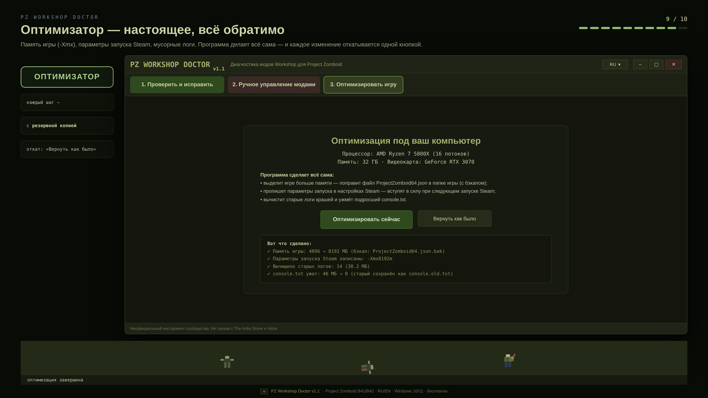](https://genocide12.github.io/pz-workshop-doctor/gallery.html#ru-9) | [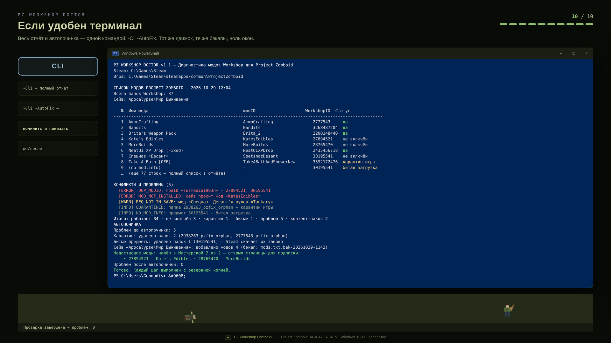](https://genocide12.github.io/pz-workshop-doctor/gallery.html#ru-10) |
| Память игры (-Xmx), параметры запуска Steam, мусорные логи — каждое изменение откатывается одной кнопкой. | -Cli -AutoFix одной командой: тот же движок, те же бэкапы, ноль окон. |

## Установка (30 секунд)

1. Скачайте `PZWorkshopDoctor.exe` (или `.ps1`) со страницы [Releases](../../releases/latest).
2. Запустите. Ставить нечего — Windows 10/11, PowerShell 5.1 или 7, игра B41/B42.

При старте — карточка «Готов к проверке», улица внизу оживает — но ничего не происходит само: проверка начинается ровно по нажатию зелёной кнопки. Никаких настроек, аккаунтов и всплывающих окон — а если на живой машине случится что-то неожиданное, окно назовёт шаг, на котором споткнулось, и продолжит работать, а не умрёт с загадочной ошибкой.

## Что реально чинится

- **Недостающие моды скачиваются за вас**: мод из `require=` ищется в Мастерской, страница подписки открывается сама; Steam качает — программа замечает и продолжает проверку сама. А если требуемого мода в Мастерской вообще нет (удалён или не публиковался)? Моды, которым он нужен — и всё, что от них зависит, — отключаются в сейвах, с бэкапом, и предупреждения исчезают навсегда.
- **Ручное управление, когда нужно**: отметьте моды галочками и нажмите «Включить отмеченные» или «Отключить отмеченные» — при включении подтянутся установленные требования, при отключении уйдут зависимые (никаких сиротских предупреждений после собственного клика), а B42-список `workshopMods.txt` синхронизируется. Клик по заголовку любой колонки сортирует таблицу — статус по смыслу, а не по алфавиту, отмеченные строки поднимаются наверх, и порядок переживает любую перепроверку. Каждое действие — один клик и один бэкап.
- Установленные, но не включённые в сейве моды — включаются в порядке зависимостей, с бэкапом `mods.txt`.
- Дубли modID (два предмета Workshop с одним id) и хвосты отписанных модов.
- Битые загрузки (без `mod.info`) — удаляются, чтобы Steam скачал заново; карты и тайлпаки распознаются как контент, а не ошибки.
- Полные описания из Мастерской, выделяемые логи и настоящий оптимизатор: память игры (`-Xmx`), параметры запуска Steam, мусорные логи — всё обратимо.

## Если удобен терминал

```powershell
powershell -ExecutionPolicy Bypass -File .\PZ-WorkshopDoctor.ps1 -Cli            # полный отчёт
powershell -ExecutionPolicy Bypass -File .\PZ-WorkshopDoctor.ps1 -Cli -AutoFix   # проверить, починить, до/после
```

## Ссылки

[Releases](../../releases/latest) · [English README](README.md) — неофициальный инструмент сообщества, не связан с The Indie Stone или Valve.
